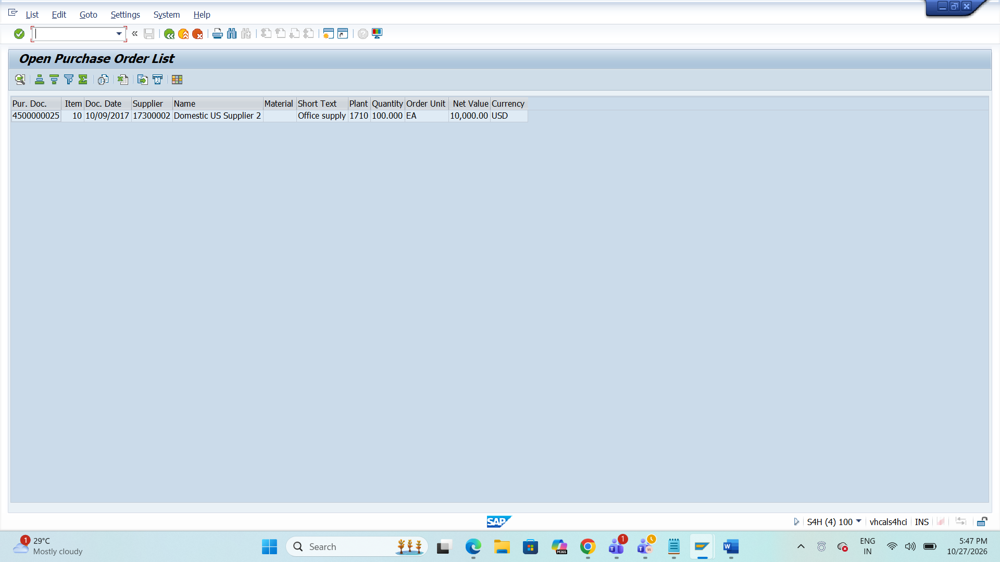
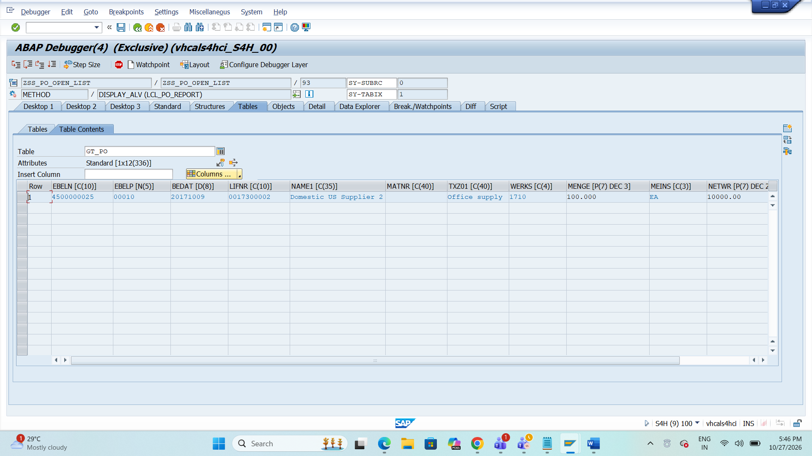
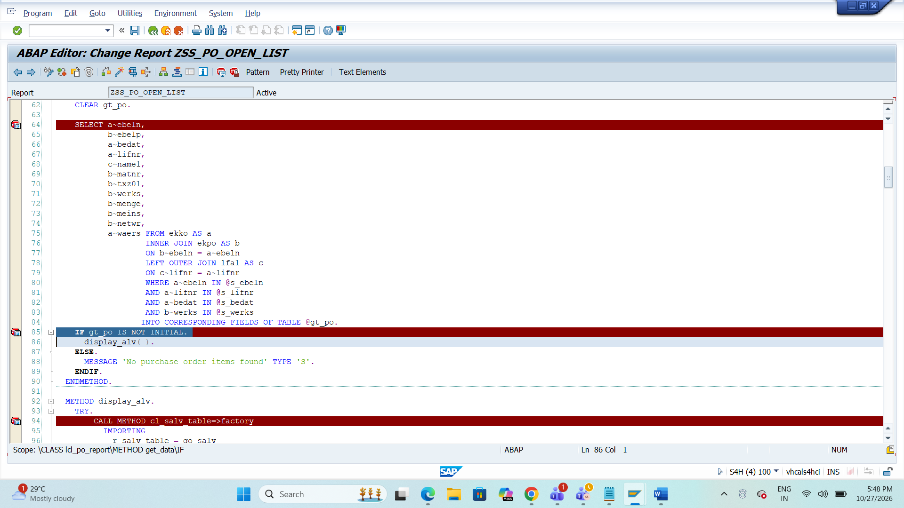

# SAP ABAP Projects

A collection of SAP ABAP development projects demonstrating Open SQL, joins, selection screens, local classes, and ALV reporting.

## Project 1: Open Purchase Order List

**Program Name:** `ZPO_OPEN_LIST`

### Overview
An SAP ABAP report designed to retrieve and display purchase order header and item information using Open SQL joins and ALV.

### Technologies
- SAP ABAP
- ABAP Open SQL
- Local Classes and Methods
- `CL_SALV_TABLE` ALV
- Debugging

### SAP Tables

| Table | Description |
|---|---|
| EKKO | Purchasing Document Header |
| EKPO | Purchasing Document Item |
| LFA1 | Vendor Master |
| MAKT | Material Descriptions |

### Features
- Selection screen for purchase order, vendor, document date, and plant
- Data retrieval using a single SELECT statement with joins
- Vendor and material information
- ALV output with optimized columns
- Debugging and execution testing

## Screenshots

### 1. ALV Output
Displays the purchase order report results in ALV format.



### 2. ABAP Debugging
Shows the ABAP report during a debugging session.



### 3. Breakpoint Screenshot
Shows the breakpoint used to inspect program execution.



## Repository Structure

```text
ai-labs/
├── SAP-ABAP-Projects/
│   ├── ALV_Output.png
│   ├── Breakpoint_Screenshot.png
│   ├── Debugging_Screenshot.png
│   ├── README.md
│   └── ZPO_OPEN_LIST.abap
└── day-01/
    └── README.md
