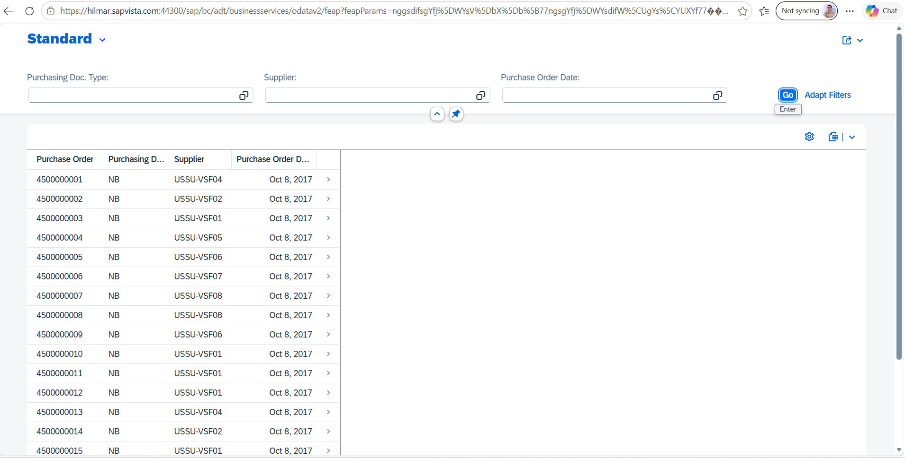

# 📦 Purchase Order Management App — SAP Fiori

A SAP Fiori List Report application developed using **SAP ABAP CDS Views, OData Services, and SAP Business Application Studio (BAS)**. The project demonstrates how backend purchase order data is exposed through an OData service and consumed by a Fiori user interface.

---

## 📌 1. Project Overview

The Purchase Order Management App connects an SAP Fiori frontend to an SAP ABAP backend.

The CDS views define the data model, the service binding exposes the service, and the generated Fiori application provides a user interface for viewing purchase order information.

### Project Objectives

- Understand how ABAP CDS views provide business data.
- Learn how service definitions and service bindings expose data through OData.
- Develop a Fiori List Report using SAP Fiori tools.
- Connect a Fiori application to an SAP ABAP On-Premise system.
- Understand the relationship between backend entities and frontend navigation.
- Practise documenting and maintaining a project using GitHub.

---

## 🏗️ 2. Application Architecture

```text
SAP ABAP Backend
       |
       v
ABAP CDS Views
       |
       v
Service Definition
       |
       v
Service Binding
       |
       v
OData Service
       |
       v
SAP Fiori List Report
       |
       v
Purchase Order Information
```

### How It Works

1. **CDS Views:** Define and retrieve the purchase order data required by the application.
2. **Service Definition:** Specifies which CDS entities are exposed through the service.
3. **Service Binding:** Publishes the service and makes it accessible through the selected protocol.
4. **OData Service:** Allows the frontend to request backend data.
5. **SAP Fiori Application:** Displays the service data through a List Report interface.

*Note: The architecture above describes the typical development flow. The exact CDS views and service definition names depend on your implementation.*

---

## 🛠️ 3. Technologies Used

| Technology | Purpose |
|---|---|
| SAP ABAP | Backend development |
| ABAP CDS Views | Data modelling and retrieval |
| Service Definition | Defines the entities exposed by a service |
| Service Binding | Exposes the service using a supported protocol |
| OData | Communication between frontend and backend |
| SAP Fiori | User interface and application experience |
| SAPUI5 | Frontend application framework |
| SAP Business Application Studio | Cloud-based development environment |
| SAP Fiori tools | Fiori application generation and development |
| Node.js and npm | Running the generated application |
| Git and GitHub | Version control and project documentation |

---

## 🔗 4. OData Service Details

| Property | Value |
|---|---|
| Service Binding Name | `ZSS_PUR_SERVICE_BINDING` |
| Main Entity | `ZS_SERVICE_PURCHASE_HEADER` |
| Navigation Entity | `to_Items` |
| Backend Type | SAP ABAP On-Premise |
| Application Template | List Report Page V2 |
| UI5 Theme | `sap_horizon` |
| UI5 Version | `1.114.9` |
| BAS Project Name | `project1` |

### Main Entity: `ZS_SERVICE_PURCHASE_HEADER`

The main entity is configured as the primary data source for the generated Fiori application.

It represents the purchase order header data exposed through the OData service.

### Navigation Entity: `to_Items`

The `to_Items` navigation property represents a relationship between purchase order header data and related item data.

When correctly configured in the backend service, this relationship can allow the application to navigate from a purchase order header to its associated items.

The actual fields and navigation behaviour depend on your CDS model and service configuration.

---

## 📸 5. Application Screenshot

The following image documents the output of the Purchase Order Management App.



**Screenshot filename:** `PurchaseOrder_App.png`

This screenshot is intended to show the generated Fiori application interface and its purchase order data.

> **Important:** Keep `PurchaseOrder_App.png` in the same directory as this README file. The filename in the Markdown image reference must match the actual filename, including uppercase and lowercase letters.

---

## ⚙️ 6. Development Steps

### Step 1: Create CDS Views

Created ABAP CDS views in the backend to model and retrieve purchase order information.

**Purpose:** CDS views provide a structured way to define data models and expose business data for consumption.

### Step 2: Configure the Service

Configured the service definition and service binding to expose the relevant CDS entities through OData.

**Purpose:** This makes the backend entities available to supported consumers, including the Fiori application.

### Step 3: Open SAP Business Application Studio

Opened BAS and selected the appropriate development environment for SAP Fiori application development.

### Step 4: Generate the Fiori Application

Used the SAP Fiori Application Generator and selected:

- **Template:** List Report Page V2
- **Module Name:** `project1`
- **Service Type:** SAP System (ABAP On-Premise)
- **Main Entity:** `ZS_SERVICE_PURCHASE_HEADER`
- **Navigation Entity:** `to_Items`

### Step 5: Connect the OData Service

Configured the application to consume the backend OData service:

`ZSS_PUR_SERVICE_BINDING`

The service URL used during generation was:

`http://hilmar.sapvista.com:50000/sap/opu/odata/sap/ZSS_PUR_SERVICE_BINDING`

**Security note:** This is an HTTP endpoint. Use only within your authorized training environment; avoid publishing credentials or sensitive system details in a public repository.

### Step 6: Run and Test the Application

Started the generated Fiori application and checked whether the user interface loaded and the configured service returned the expected data.

### Step 7: Capture the Output

Captured the application screenshot and saved it as:

`PurchaseOrder_App.png`

### Step 8: Document the Project

Added the application details, architecture, technologies, development steps, and screenshot reference to this README.

---

## ▶️ 7. Running the Application

Run these commands from the Fiori application's root directory.

### Install Dependencies

```bash
npm install
```

### Start the Application

```bash
npm start
```

### Start with Mock Data

```bash
npm run start-mock
```

**Important:** Mock mode uses simulated data. It does not, by itself, verify that the live SAP backend service is working.

The available commands depend on the generated project's configuration and installed dependencies.

---

## 🧪 8. Testing Checklist

Use this checklist to verify the application.

- [ ] The Fiori application starts successfully.
- [ ] The List Report page loads.
- [ ] The configured OData service is reachable.
- [ ] Purchase order data is displayed correctly.
- [ ] The main entity is configured correctly.
- [ ] The `to_Items` navigation property is available where expected.
- [ ] Backend authorizations allow the required data access.
- [ ] The application screenshot is visible in the GitHub README.
- [ ] The project files are committed and pushed to GitHub.

---

## 📚 9. What I Learned

Through this project, I practised:

- Creating and using ABAP CDS views.
- Understanding the relationship between CDS entities and OData services.
- Learning the role of service definitions and service bindings.
- Generating a Fiori List Report application.
- Connecting a Fiori frontend to an SAP ABAP backend.
- Understanding entity navigation between headers and items.
- Running and testing a generated SAPUI5 application.
- Documenting project work using Markdown and GitHub.

---

## 🚀 10. Future Improvements

Possible enhancements for future versions include:

- Improve the List Report columns and filter options.
- Add meaningful labels and annotations to the CDS entities.
- Improve header-to-item navigation.
- Add appropriate search and filtering capabilities.
- Handle service errors and empty results clearly.
- Apply suitable authorization checks.
- Improve the user experience with SAP Fiori design guidelines.
- Add automated tests where appropriate.

These are potential improvements, not features claimed to be implemented already.

---

## 📂 11. Project Structure

The following is an illustrative structure. Keep the actual files generated by SAP Fiori tools.

```text
project1/
├── README.md
├── PurchaseOrder_App.png
├── package.json
├── ui5.yaml
├── webapp/
│   ├── Component.js
│   ├── manifest.json
│   └── other application files
└── other generated configuration files
```

---

## 👩‍💻 12. Project Information

| Property | Details |
|---|---|
| Project | Purchase Order Management App |
| Development Environment | SAP Business Application Studio |
| Frontend | SAP Fiori / SAPUI5 |
| Backend | SAP ABAP On-Premise |
| Data Model | ABAP CDS Views |
| Service Communication | OData |
| Application Template | List Report Page V2 |
| Project Folder | `project1` |

---

### Key Learning

**CDS Views → Service Definition → Service Binding → OData → SAP Fiori List Report**

This project demonstrates the development flow used to expose SAP backend data and consume it through a Fiori application.
