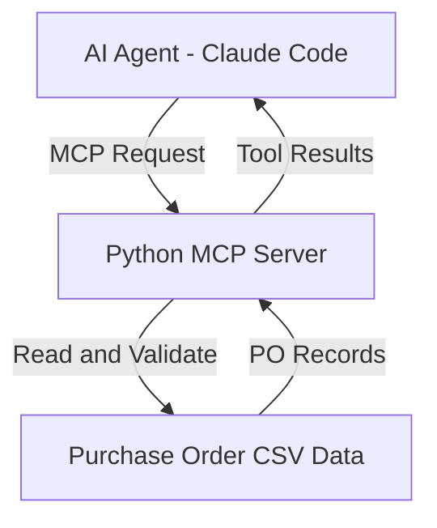

# Day 7 – Phase 5: Agentic AI & Apps
## Codex, Safe Coding Habits, MCP Server and Invoice-to-Insight Capstone

## 1. Overview

Day 7 focuses on Agentic AI, OpenAI Codex, Claude Code, safe AI coding practices, and Model Context Protocol (MCP).

The practical exercises demonstrate how AI coding agents can work with external tools through an MCP server and access purchase order data. The final capstone implements invoice extraction into JSON and purchase order validation using an MCP server.

## 2. Today's Learning Objectives

- Understand OpenAI Codex and its different working environments.
- Compare Claude Code and Codex.
- Understand vibe coding and spec-driven development.
- Learn five golden rules of safe AI coding.
- Understand AI agents and MCP architecture.
- Build and test a Python MCP server.
- Complete the Invoice-to-Insight Capstone.

## 3. New Terms

| Term | Meaning |
|---|---|
| Pull Request (PR) | A set of proposed code changes submitted for review before merging. |
| Sandbox | An isolated environment where an AI agent can work safely. |
| Diff | A comparison showing added, modified, or deleted lines. |
| Spec | A short document describing what to build and how to test it. |
| Vibe Coding | Accepting AI-generated code without properly reviewing it. |

## 4. OpenAI Codex – Four Ways to Work

Codex provides different ways to work with AI-assisted software development.

1. **ChatGPT Desktop App:** Work with coding tasks through the ChatGPT application.
2. **CLI:** Run Codex from a project directory using the command line.
3. **IDE Extension:** Use supported development environments such as VS Code and JetBrains.
4. **Cloud:** Delegate coding tasks to a cloud environment and review the proposed changes.

### Codex Workflow

- Create clear tasks.
- Delegate work to coding agents.
- Allow agents to work in their supported environments.
- Review the changes and pull requests.
- Accept only the changes that meet the requirements.

## 5. Claude Code vs Codex

| Claude Code | Codex |
|---|---|
| Useful for focused coding sessions. | Useful for delegating coding tasks. |
| Supports Plan Mode. | Supports agent-based coding workflows. |
| Uses `CLAUDE.md` for project instructions. | Uses `AGENTS.md` for project instructions. |
| Supports hooks, skills and plugins. | Supports coding workflows in supported environments. |
| Supports MCP connections. | Supports MCP connections where configured. |

### What Both Share

- AI agent workflows.
- Project instruction files.
- Tool integrations.
- MCP connections.
- Human review before accepting changes.

**Important:** The developer is responsible for reviewing and approving AI-generated code.

## 6. Vibe Coding vs Spec-Driven Development

### Vibe Coding

Vibe coding means describing a task informally and accepting AI-generated code without carefully reviewing it.

Suitable for:
- Learning experiments.
- Throwaway scripts.
- Simple prototypes and demos.

Not suitable for:
- Production SAP applications.
- Payroll and financial processing.
- Customer data.
- Security-sensitive applications.

### Spec-Driven Development

Spec-driven development follows a structured process:

1. Write the specification.
2. Define requirements and edge cases.
3. Ask the agent to prepare a plan.
4. Review the plan.
5. Implement changes in small steps.
6. Run automated tests.
7. Review the Git diff.
8. Approve and merge the changes.

**Professional workflow:**

`Spec → Plan → Implementation → Tests → Diff Review → Approval`

## 7. Five Golden Rules of AI Coding

1. **Small Tasks:** Give one clear task and one expected result per instruction.
2. **Plan Before Acting:** Review the plan before allowing important changes.
3. **Tests Are the Proof:** Verify the output using automated tests.
4. **Git Is Your Safety Belt:** Commit known-good work and use version history.
5. **You Merge It, You Own It:** Review and take responsibility for all accepted code.

## 8. Hands-On Practice – Same Task, Second Agent

The practical exercise involves:

1. Commit the existing project.
2. Create a `spec.md` file.
3. Define the goal, rules and completion criteria.
4. Ask the second coding agent to implement the specification.
5. Compare the changes using `git diff`.
6. Run tests and select the implementation that best satisfies the requirements.

### Spec Template

```text
# spec.md

GOAL:
What must the feature do?

RULES:
Define validation rules and edge cases.

DONE WHEN:
New unit tests pass.
Existing tests continue to pass.

DON'T:
Add unnecessary packages or unrelated changes.
```

## 9. Day 7 Practical Lab – 8 Hours

| Task | Activity | Duration |
|---|---|---|
| Task 1 | Codex Round 2 | 1 hour |
| Task 2 | Build a Python MCP Server | 3 hours |
| Task 3 | Invoice-to-Insight Capstone | 3.5 hours |
| Task 4 | Proof and Lab Log | 0.5 hour |

## 10. Task 1 – Codex Round 2

**Objective:** Practise using a second AI coding agent and compare its implementation with Claude Code.

### Activities
- Practised AI-assisted coding.
- Worked with the Codex workspace.
- Used project specifications and coding instructions.
- Organised and saved the exercise in the Day 7 repository.

**Status:** Completed.

## 11. Task 2 – Python MCP Server

**Objective:** Build a Python MCP server with tools to access purchase order information.

### Activities

- Created the `po-mcp` project.
- Installed the Python MCP SDK.
- Developed the MCP server using FastMCP.
- Connected the server to purchase order CSV data.
- Implemented purchase order lookup and late PO listing tools.
- Connected the MCP server to Claude Code.
- Tested the MCP tools.

### MCP Tools

| Tool | Purpose |
|---|---|
| `get_po(po_number)` | Retrieve a purchase order using its PO number. |
| `list_late_pos(today)` | Retrieve purchase orders that are late. |

### Important Learning

For an MCP server using standard input/output transport, avoid using `print()` for ordinary output because it can interfere with the protocol communication. Use logging instead.

**Status:** Completed.

## 12. Task 3 – Invoice-to-Insight Capstone

**Objective:** Build an invoice extraction workflow and validate purchase orders through an MCP server.

### Activities

1. Created the final project specification.
2. Developed `extract_invoice.py`.
3. Processed invoice information into structured JSON.
4. Prepared two invoice JSON files.
5. Created automated unit tests.
6. Developed a purchase order validation MCP server.
7. Connected the server to purchase order CSV data.
8. Tested purchase order lookup and vendor validation.
9. Tested the PO-not-found scenario.

### Automated Test Results

| Test Case | Result |
|---|---|
| Invoice 1 extraction | Passed |
| Invoice 2 extraction | Passed |
| Missing fields validation | Passed |
| Invalid JSON validation | Passed |
| Total automated tests | 4/4 Passed |

### Additional Validation

- Python compilation completed successfully.
- PO lookup tested successfully.
- Vendor match tested successfully.
- Vendor mismatch tested successfully.
- PO-not-found scenario tested successfully.

### Task 3 Project Structure

```text
task-3/
├── spec.md
├── extract_invoice.py
├── invoices/
│   ├── invoice1.json
│   └── invoice2.json
├── tests/
│   └── test_extract_invoice.py
├── po-mcp/
│   ├── server.py
│   └── data/
│       └── po_list.csv
└── screenshots/
    ├── Day7-Task3-MCP-PO-Not-Found.png
    └── day-07-task-3-extraction-tests-passed.png
```

**Status:** Completed.

## 13. Task 4 – Proof and Lab Log

**Objective:** Document the Day 7 activities and demonstrate the communication flow between an AI agent, MCP server and external data.

### Architecture Diagram



### Architecture Explanation

1. The AI agent sends a request to the MCP server.
2. The MCP server receives the requested tool call.
3. The server accesses purchase order CSV data.
4. The server processes the request and returns the result.
5. The AI agent receives the tool result.

### Proof and Documentation

- Day 7 Tasks 1, 2 and 3 were pushed to GitHub.
- Task 3 extraction tests passed.
- MCP server testing was completed.
- Architecture diagram included in the lab log.
- Task 4 lab log is maintained separately in `task-4/lab-log.md`.

**Task 4 status:** Documentation prepared; final GitHub push must be verified.

## 14. Technologies and Tools Used

- Python
- FastMCP
- Model Context Protocol (MCP)
- Claude Code
- OpenAI Codex
- JSON
- CSV
- Python Unit Testing
- Git
- GitHub
- VS Code / BAS development environment

## 15. Key Learnings

- Understood AI agents and their role in software development.
- Learned the differences between Claude Code and Codex.
- Understood safe AI coding practices.
- Learned spec-driven development.
- Practised building a Python MCP server.
- Connected an MCP server with Claude Code.
- Learned how to access and validate CSV data.
- Practised invoice extraction and JSON handling.
- Implemented automated unit tests.
- Improved Git and GitHub project management skills.

## 16. GitHub Repository

**Repository:** https://github.com/Sanishaik/ai-labs

**Project Folder:** `day-07/`

Tasks 1, 2 and 3 have been committed and pushed successfully.

Latest confirmed GitHub commit before Task 4 documentation: `b9ba502`.

## 17. Day 7 Completion Summary

| Task | Description | Status |
|---|---|---|
| Task 1 | Codex Round 2 | Completed |
| Task 2 | Python MCP Server | Completed |
| Task 3 | Invoice-to-Insight Capstone | Completed |
| Task 4 | Proof and Lab Log | Documentation prepared; final push pending |

## 18. Conclusion

Day 7 provided practical experience with AI coding agents, safe coding habits, Python MCP server development, invoice extraction and purchase order validation.

The exercises demonstrated how an AI agent can communicate with external tools through an MCP server and access business data.

The most important lesson is:

**Spec First. Small Steps. Tests. Git. Review Every Change. You Own the Code You Merge.**
