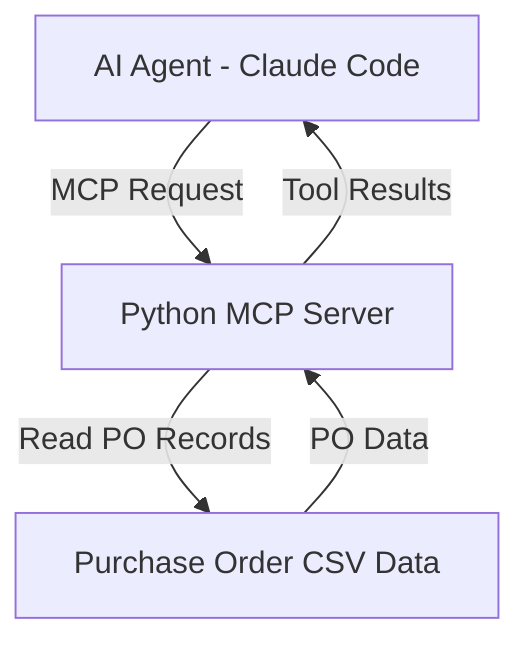

# Day 7 – Lab Log
## AI Agent, MCP Server and Invoice-to-Insight

**Date:** 9 November 2026

### 1. Objective
To understand how AI agents communicate with MCP servers and access external data using tools.

### 2. Tasks Completed

#### Task 1 – Codex Workspace
- Completed the Codex workspace exercise.
- Practised using AI coding tools.
- Organised the project files.

#### Task 2 – Python MCP Server
- Created a Python MCP server using FastMCP.
- Connected the server to purchase order CSV data.
- Implemented MCP tools to retrieve and validate purchase orders.
- Tested the MCP server through Claude Code.

#### Task 3 – Invoice-to-Insight Capstone
- Created a Python invoice extraction script.
- Extracted invoice information into structured JSON files.
- Created automated unit tests.
- Developed an MCP server for purchase order validation.
- Tested PO lookup, vendor matching, vendor mismatch and PO-not-found scenarios.

### 3. Test Results
- Invoice extraction tests: **4/4 passed**.
- Python compilation: Successful.
- PO lookup: Successful.
- Vendor match and mismatch: Tested successfully.
- PO not found scenario: Tested successfully.

### 4. Architecture Diagram

The AI agent sends requests to the MCP server. The MCP server accesses purchase order data and returns the results to the AI agent.

### 5. GitHub Proof
- Repository: https://github.com/Sanishaik/ai-labs
- Day 7 Task 1: Pushed to GitHub.
- Day 7 Task 2: Pushed to GitHub.
- Day 7 Task 3: Pushed to GitHub.
- Latest confirmed GitHub commit before Task 4: `b9ba502`.

### 6. Key Learnings
- Understood the role of AI agents.
- Learned how MCP connects AI agents with external tools.
- Practised developing a Python MCP server.
- Learned how to read and validate CSV data.
- Practised invoice extraction and JSON handling.
- Learned automated testing using Python.
- Practised Git commits and GitHub push operations.

### 7. Completion Status
- Task 1 – Completed.
- Task 2 – Completed.
- Task 3 – Completed.
- Task 4 – Lab log and architecture diagram prepared.

**Overall Day 7 Status: Completed.**